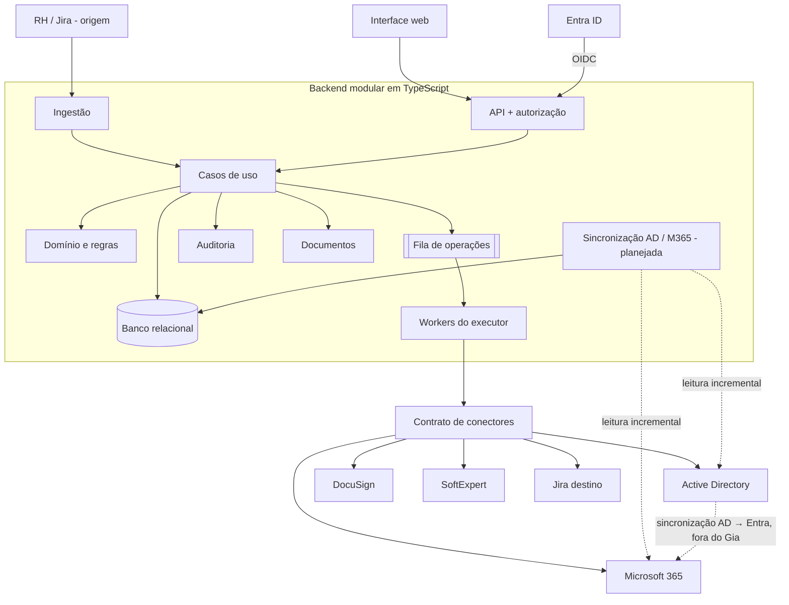

# Gia — Estrutura e Funcionalidades

O Gia será uma **aplicação escalável, escrita inteiramente em TypeScript**, que gerencia o ciclo de vida dos acessos de colaboradores: recebe pedidos do RH, propõe acessos, registra a decisão humana e executa as operações em Active Directory, Microsoft 365, DocuSign, SoftExpert e Jira.

> **Este documento descreve a arquitetura e as funcionalidades alvo.** Nem tudo aqui está implementado. Cada módulo, funcionalidade e tela traz o seu status:
>
> | Status | Significado |
> | --- | --- |
> | **Implementado** | Existe no código e tem teste automatizado. Não significa validado em produção. |
> | **Parcial** | Parte existe; o que falta está descrito no próprio item. |
> | **Planejado** | Faz parte do alvo, mas ainda não existe no código. |
> | **Standby** | Previsto na estrutura, fora da implementação atual por decisão de escopo. |
>
> O estado atual do código está no [README](../README.md#o-que-ainda-não-existe), e o que bloqueia produção, no [runbook de produção](operacao/producao.md#pendências-para-produção). Os conectores reais existem, mas **nenhum foi validado em ambiente real**, e as sessões ainda ficam em memória de um único processo. Este documento não é evidência de prontidão.

## Visão geral

O Gia responde, para cada acesso de cada colaborador, **o que foi solicitado, aprovado, tentado e confirmado, por quem e quando**. Ele reduz a digitação repetida e os esquecimentos, mas mantém um humano decidindo antes de qualquer escrita nos sistemas.

O ciclo principal tem cinco passos:

1. **Receber** o chamado aberto pelo RH no Jira, identificado como celetista ou terceiro, e deduplicar.
2. **Propor** identidade e acessos a partir de regras de área e cargo.
3. **Revisar e decidir**: o operador ajusta, aprova ou rejeita.
4. **Executar** as operações nos sistemas de destino, item por item.
5. **Comprovar** o resultado de cada sistema e manter o histórico da pessoa.

**Escopo atual:** somente **onboarding** (criação de acessos), para celetistas e terceiros. O **offboarding** (inativação de acessos) está **em standby**: fica previsto na estrutura, mas não será implementado agora.

### Usuários e papéis

Os papéis estão implementados no domínio (`packages/dominio/src/autorizacao/permissoes.ts`) e são aplicados no servidor.

| Papel | Responsabilidade |
| --- | --- |
| Solicitante (RH) | Abre e acompanha pedidos; nunca escreve nos sistemas de destino. |
| Revisor/aprovador | Ajusta propostas, aprova ou rejeita pedidos. |
| Executor | Provisiona, revoga, reprocessa, registra acessos manuais e reconcilia. |
| Auditor | Consulta histórico e exporta evidências, somente leitura. |
| Administrador técnico | Configura integrações, segredos e a liberação de escrita por sistema. |
| Administrador do Gia | Perfil abrangente do [ADR-0007](adr/0007-perfil-administrador-gia.md): executa todas as ações funcionais, com escopo total. **Não** configura segredos nem libera escrita (exclusivos do administrador técnico), e **não** executa as ações técnicas do worker (registrar resultado de operação, consolidar execução). Toda ação continua auditada, e aprovar continua sem escrever nos destinos. |
| Serviço executor | Identidade técnica que executa operações em nome do humano que as solicitou. |
| Colaborador | Beneficiário dos acessos; não usa o Gia diretamente. |

## Aplicação escalável em TypeScript

Todo o Gia é escrito em **TypeScript com `strict` ligado**, em Node.js no servidor e no navegador na interface, compartilhando tipos de contrato entre as duas pontas. A aplicação nasce como **monólito modular** que escala horizontalmente e pode ter partes separadas em serviços independentes sem reescrever o domínio.

### Stack

| Camada | Definição |
| --- | --- |
| Linguagem | TypeScript em todo o código (backend, executor, adaptadores, interface, testes). |
| Runtime | Node.js LTS no servidor. |
| Interface | Aplicação web em TypeScript (SPA), consumindo apenas a API do Gia. |
| Contratos | Pacote compartilhado de tipos e esquemas, validados em runtime nas fronteiras (entrada HTTP, Jira, respostas de fornecedores). Módulos que usam o Node (segredos, servidor de métricas) ficam em subpaths próprios e nunca entram no bundle do navegador. |
| Persistência | Um banco relacional único, acessado por uma camada de repositórios tipada. |
| Execução assíncrona | Fila durável de operações consumida por workers do executor. |
| Autenticação | Entra ID via OIDC no servidor; sessão em cookie seguro, sem tokens no navegador. |

### Requisitos de escalabilidade

Requisitos do alvo. O status atual vem entre parênteses.

- **API sem estado** (*Parcial*): qualquer instância deve atender qualquer requisição, com sessões e locks em armazenamento compartilhado, nunca na memória do processo. **Hoje as sessões ficam na memória da API**, que, portanto, ainda não escala horizontalmente (ver o runbook).
- **Execução desacoplada da requisição** (*Implementado*): a API grava a intenção e responde na hora; workers consomem a fila. O clique do operador nunca espera uma chamada ao AD ou ao Graph.
- **Workers escaláveis** (*Implementado*): o número de workers cresce de forma independente da API. Cada operação é reservada com lease, então dois workers nunca executam a mesma operação.
- **Concorrência por destino** (*Parcial*): o limite configurável de chamadas simultâneas por destino existe. O respeito a rate limit e `Retry-After` depende de cada conector.
- **Idempotência** (*Implementado*): toda operação tem chave única; reprocessar ou reiniciar um worker nunca duplica uma conta nem repete um sucesso confirmado.
- **Leitura separada da escrita** (*Planejado*): filas, consulta de usuários e auditoria com consultas paginadas e projeções de leitura indexadas. Hoje a listagem de pedidos não tem paginação no servidor.
- **Separação sob demanda** (*Planejado*): ingestão, executor, sincronização com AD e M365 e geração de documentos são módulos com fronteira própria e podem virar processos ou serviços separados quando o volume exigir, sem mudar o modelo de negócio.
- **Observabilidade** (*Implementado*): logs estruturados com ID de correlação e métricas Prometheus em porta interna, sem dados pessoais. Alertas são sugeridos no runbook e ainda não estão configurados num ambiente.
- **Configuração por ambiente** (*Implementado*): validada no arranque, com escrita nos destinos **desligada por padrão**.

## Estrutura da aplicação

Um repositório TypeScript (monorepo) com **um backend modular, uma interface e um banco**; somente o executor escreve nos sistemas de destino, e nenhum módulo acessa as tabelas de outro diretamente.



A interface nunca recebe chaves de conector, a ingestão nunca aprova pedidos sozinha e a sincronização AD → Entra acontece fora do Gia.

### Organização do repositório

```
gia/
├─ apps/
│  ├─ api/            # HTTP, autenticação, autorização, casos de uso
│  ├─ worker/         # executor, smoke e preflight; ingestão e sincronização planejadas
│  └─ web/            # interface do operador
├─ packages/
│  ├─ dominio/        # entidades, regras e transições, sem I/O
│  ├─ contratos/      # tipos e esquemas compartilhados API ↔ web
│  ├─ conectores/     # adaptadores AD, M365, DocuSign, SoftExpert, Jira
│  ├─ persistencia/   # repositórios, migrações, outbox
│  └─ documentos/     # geração do formulário de acessos
└─ tests/             # simuladores de fornecedores e cenários ponta a ponta
```

`api` e `worker` são processos distintos que compartilham os mesmos pacotes. O worker já escala por número de instâncias; a API só escala depois que as sessões saírem da memória.

### Camadas

1. **Domínio:** entidades, estados e regras puras, testáveis sem banco nem rede.
2. **Casos de uso:** orquestram um comando (aprovar, provisionar, reconciliar), aplicam guardas de status, versão e permissão, e gravam estado + evento na mesma transação.
3. **Adaptadores:** banco, fila, conectores de fornecedor, Entra ID, gerador de documentos. Implementam interfaces definidas pelo domínio.
4. **Entrega:** rotas HTTP da API e telas da interface.

### Módulos

| Módulo | Responsabilidade | Status |
| --- | --- | --- |
| Pessoas e pedidos | Identidade perene do colaborador; pedidos de admissão, desligamento e acesso avulso; deduplicação e transições. | **Parcial**: admissão implementada; desligamento em standby; acesso avulso planejado. |
| Regras e proposta | Calcula identidade e itens a partir das regras; produz revisão imutável e explica a origem de cada sugestão. | **Implementado**, com regras de área e cargo fictícias no código. |
| Aprovação | Decide pedidos com guardas de status, versão e permissão; nunca chama sistemas externos. | **Implementado** |
| Execução | Fila de operações, reserva com lease, tentativas, dependências entre etapas, resultado por item e retomada. | **Implementado** |
| Conectores | Implementam as cinco operações por sistema e traduzem o protocolo de cada fornecedor. | **Implementado** (simuladores e transportes reais), sem validação em ambiente real. |
| Reconciliação | Compara o registrado com o estado real e resolve operações incertas com decisão humana. | **Parcial**: operações incertas vão para `aguardandoReconciliacao`; os comandos `conferirExistencia` e `reconciliar` respondem `501 ACAO_INDISPONIVEL`. |
| Configuração | Regras de área e cargo, catálogos e parâmetros, versionados e auditados. | **Parcial**: configuração por ambiente e padrões no código; edição pela interface planejada. |
| Perfil e auditoria | Projeções de leitura, linha do tempo de acessos por pessoa e exportações. | **Parcial**: eventos imutáveis e histórico por pedido existem; perfil por pessoa e exportações planejados. |
| Documentos | Formulário de acessos com o que foi confirmado. | **Parcial**: DOCX pela API; botão na interface e PDF planejados. |
| Retenção | Anonimização por lotes, com simulação prévia. | **Planejado** |
| Sincronização de diretório | Lê o AD (LDAPS) e o M365 (Graph, consultas delta) de forma incremental, atualiza o espelho de usuários e gera eventos para mudanças feitas fora do Gia. | **Planejado**. Hoje a API só consulta o diretório sob demanda, para checar o uso de identidade na proposta. |

### Contratos

- **Comando:** `pedidoId`, `versaoEsperada`, ação e dados permitidos. O ator vem sempre da sessão no servidor.
- **Resposta:** novo status, nova versão, ID da operação e, em caso de recusa, um código estável com mensagem em português.
- **Resultado de conector:** efeito `confirmado`, `parcial`, `semEfeito` ou `desconhecido`; modo `real` ou `simulado`; etapa, código, referência externa e mensagem sanitizada.

### Fluxo de execução

1. O operador aprova → a API grava decisão + revisão + evento numa transação e responde, **sem escrita externa**.
2. O operador solicita execução → a API grava a operação na fila (outbox) + evento e responde "aceita".
3. Um worker reserva a operação com lease, chama o conector e grava efeito, estado e evento.
4. Se a resposta se perder ou a gravação falhar, a operação vai para reconciliação; nada é reenviado às cegas.

## Funcionalidades

O alvo prevê onze funcionalidades; a admissão é o fluxo central e as demais dão suporte, recuperação ou consulta. Situação atual:

| # | Funcionalidade | Status |
| --- | --- | --- |
| 1 | Admissão | **Implementado** (validar nos sistemas e regerar proposta, planejados) |
| 2 | Provisionamento | **Implementado** |
| 3 | Conferência e registro manual | **Parcial**: só o registro manual |
| 4 | Reconciliação | **Planejado** (`501 ACAO_INDISPONIVEL`) |
| 5 | Desligamento | **Standby** |
| 6 | Acesso avulso | **Planejado** |
| 7 | Consulta de usuários (Perfil 360º) | **Planejado** |
| 8 | Auditoria | **Parcial**: eventos e histórico por pedido; tela e exportações planejadas |
| 9 | Configuração | **Planejado** (hoje por ambiente e padrões no código) |
| 10 | Documento de acessos | **Parcial**: DOCX pela API |
| 11 | Retenção de dados | **Planejado** |

### 1. Admissão — Implementado

Recebe chamados do Jira, com um request type para celetista e outro para terceiro, normaliza os campos e deduplica pelo ID da issue. O tipo de vínculo fica registrado no pedido e define quais sistemas entram na proposta (configurável por vínculo; ver Configuração). Gera uma proposta com identidade e um item por sistema habilitado. O operador revisa e decide.

| Estado | Ações disponíveis |
| --- | --- |
| Pendente de aprovação | Editar identidade e parâmetros dos itens; recalcular identidade; aprovar; rejeitar com motivo. *Planejado:* validar nos sistemas; regerar proposta. |
| Aprovado | Solicitar a execução (provisionar); reabrir. |
| Em execução | Acompanhar o resultado por item. |
| Concluído com erros | Reprocessar só os itens pendentes ou com erro; registrar acesso manual; reabrir. |
| Concluído | Consultar e emitir documento (pela API). |
| Rejeitado | Reabrir para revisão. |

- **Identidade sugerida** (*Implementado*): sai do e-mail corporativo sugerido pelo RH. O login é a parte local do e-mail (até 20 caracteres, o limite do AD); o UPN e o e-mail são o próprio endereço; `proxyAddresses` recebe `SMTP:<e-mail>`; o nome de exibição é o nome completo. O Gia só verifica colisão e uso (AD, M365 e o próprio Gia) e **não gera login alternativo**. E-mail ausente ou inválido, login acima do limite ou colisão viram pendência para **ajuste humano** da identidade (`origem: ajusteManual`): aprovar exige identidade presente, verificada com os valores atuais e não usada por outra pessoa.
  - *Planejado (alvo):* um login alternativo a partir do nome + iniciais dos sobrenomes, até 20 caracteres, quando o e-mail não servir. Hoje não existe; esse caso depende do ajuste humano.
- **Itens por regra:** OU, departamento e grupos AD; perfil e grupo DocuSign; área, função e grupo SoftExpert; grupos Jira; plano de licenças e grupo M365.
- **Revisão congelada:** a proposta aprovada guarda a versão das regras usada; mudar regras depois não altera o que já foi aprovado. Novos itens exigem nova aprovação.

### 2. Provisionamento — Implementado

Executa os itens aprovados de forma assíncrona e mostra o resultado por sistema: confirmado, parcial, falhou, desconhecido ou aguardando dependência. Itens confirmados nunca são reexecutados. O M365 aguarda a identidade sincronizada pelo AD antes de licenciar. A escrita real só acontece com os gates de escrita ligados, o que nunca ocorreu em ambiente real até agora.

### 3. Conferência e registro manual — Parcial

- **Conferir existência** (*Planejado*): consulta o estado atual de cada conta nos sistemas, sem alterar o resultado registrado. Hoje o comando responde `501 ACAO_INDISPONIVEL`.
- **Validar** (*Planejado*): ensaia a criação e lista impedimentos e avisos, sem gravar nada no destino.
- **Registrar acesso manual** (*Implementado*): o operador declara um acesso feito fora do Gia, com observação; fica auditado.

### 4. Reconciliação — Planejado

Para operações paradas ou com resultado desconhecido: gera relatório (somente leitura), o operador revisa e confirma o desfecho com a versão vista; o sistema consulta os destinos de novo antes de gravar. Encontrar a conta não marca o item como sucesso automaticamente. Hoje o worker já leva a escrita incerta para `aguardandoReconciliacao`, sem reenviar, mas o comando `reconciliar` ainda responde `501 ACAO_INDISPONIVEL`.

### 5. Desligamento — Standby

Em standby: previsto na estrutura, fora da implementação atual. Pedido ligado a uma pessoa existente, com checklist de tarefas por sistema: desabilitar e mover a conta AD, remover licenças M365, encerrar usuário DocuSign, inativar SoftExpert, remover grupos Jira. Fluxo: aprovar → executar → acompanhar tarefas → reprocessar só as falhas. Antes de revogar, captura um snapshot dos acessos. Ao concluir, marca a pessoa como desligada.

### 6. Acesso avulso — Planejado

Solicitação de acesso a um recurso específico: submetido → aprovado ou negado → concedido → revogado. É um **registro de execução manual**; a tela deixa claro que nenhum conector foi acionado.

### 7. Consulta de usuários (Perfil 360º) — Planejado

Aba que espelha os usuários do Active Directory e do Microsoft 365 e mostra, para cada pessoa, os acessos que ela tem hoje e uma **linha do tempo de todos os acessos que ela já teve**. Nada desta seção existe ainda: não há espelho do diretório, job de sincronização, busca nem exportação.

- **Busca:** por nome, login, e-mail, CPF ou matrícula, sobre o espelho sincronizado do AD. Inclui contas desabilitadas e pessoas que nunca passaram por um pedido do Gia.
- **Sincronização com o AD:** um job do worker lê o diretório periodicamente de forma incremental (só os objetos alterados desde a última leitura) e compara status da conta, OU, atributos e grupos com o último estado conhecido. Cada diferença vira um evento na linha do tempo. O mesmo acontece no Microsoft 365, via Graph com consultas delta, para licenças e grupos de nuvem.
- **Acessos atuais:** grupos AD, licenças M365 e contas nos demais sistemas, cada um com a data em que foi confirmado pela última vez.
- **Linha do tempo:** eventos em ordem cronológica, do mais recente ao mais antigo, com instante, sistema, o que mudou (antes → depois), quem fez e link para o pedido de origem. Filtros por sistema, período e tipo de evento; exportação em CSV e PDF.

| Evento na linha do tempo | Origem |
| --- | --- |
| Conta criada, desabilitada ou reabilitada no AD | Gia ou sincronização |
| Grupo AD adicionado ou removido | Gia ou sincronização |
| Mudança de cargo, departamento, OU ou gerente | Sincronização |
| Licença M365 atribuída ou removida | Gia ou sincronização |
| Grupo de nuvem M365 adicionado ou removido | Gia ou sincronização |
| Conta criada ou encerrada em DocuSign, SoftExpert ou Jira | Gia |
| Pedido aberto, aprovado ou rejeitado | Gia |
| Acesso avulso concedido ou revogado | Gia |

Mudanças feitas **fora do Gia** (por exemplo, alguém adicionou um grupo direto no AD) aparecerão marcadas como "detectado na sincronização", sem ator do Gia.

**Limite importante:** o AD não guarda o histórico de quem alterou um grupo nem quando. Por isso a linha do tempo começará na **primeira sincronização**: o que já existir nesse momento aparece como "estado inicial", e alterações posteriores feitas fora do Gia carregam o instante em que foram detectadas. O mesmo vale para licenças e grupos do M365.

### 8. Auditoria — Parcial

**Implementado:** todo evento é gravado de forma imutável, e o histórico de cada pedido aparece na API (`GET /pedidos/:pedidoId/historico`) e no detalhe do pedido na interface.

**Planejado:** a tela de consulta de eventos, com filtros por período, tipo, status, colaborador e ator; paginação de 25, 50 ou 100; e exportação em CSV, Excel e PDF dos resultados filtrados.

### 9. Configuração — Planejado

**Hoje:** a configuração vem do ambiente, validada no arranque, e dos padrões no código. Isso inclui as regras de área e cargo (fictícias) e os sistemas habilitados por vínculo. Não há tela, versionamento nem auditoria de mudanças de configuração.

**Planejado:** abas Geral, AD, DocuSign, SoftExpert, Jira e M365, mapeamentos por área e cargo, catálogos de grupos AD e funções SoftExpert. Fluxo: editar → simular as diferenças → confirmar. Teste de conexão por sistema.

**Sistemas por vínculo:** cada sistema tem as opções "habilitado para celetista" e "habilitado para terceiro", e a proposta só gera itens para os sistemas marcados no vínculo do pedido. Enquanto a regra de terceiros não for definida, todos os sistemas nascem desligados para terceiro, para que nenhum pedido gere acesso por engano. No alvo, toda mudança será versionada e auditada.

### 10. Documento de acessos — Parcial

**Implementado:** o formulário de acessos em DOCX, pela API (`GET /pedidos/:pedidoId/documento`), só com os acessos confirmados e a identidade efetiva. O download é protegido por permissão, sem cache, e registra quem baixou.

**Planejado:** o botão de download na interface e a versão em PDF.

### 11. Retenção de dados — Planejado

Tarefa agendada que anonimiza dados de pessoas desligadas após o prazo configurado, em lotes, com modo simulação e confirmação explícita para produção. Eventos de auditoria permanecem.

## Regras de negócio essenciais

Estas regras valem em todo o sistema e cada uma tem teste automatizado correspondente.

1. **Aprovar não executa.** A aprovação grava a decisão; nada é criado ou revogado nos sistemas externos.
2. **Cinco operações distintas por conector:** testar conexão, validar, conferir existência, provisionar e revogar.
3. **Timeout é resultado desconhecido.** Nunca é tratado como sucesso nem como falha; vai para conferência.
4. **Sucesso confirmado não se repete.** Reexecuções tocam apenas o que falta.
5. **Conta ausente na revogação é falha;** acesso já revogado é sucesso.
6. **Existir não é sucesso.** Encontrar a conta não prova que todos os acessos foram concedidos.
7. **M365 não cria usuário.** Licencia a identidade que já chegou ao Entra ID pela sincronização do AD.
8. **Escrita desligada por padrão.** Cada sistema e cada operação (criar, revogar) é liberado separadamente.
9. **Simulado não é confirmado.** Resultado simulado nunca vira sucesso nem gera documento.
10. **Uma origem, um pedido.** O mesmo ID do Jira nunca gera dois pedidos; uma pessoa pode ter vários pedidos.
11. **Evidência imutável.** Eventos de auditoria só são inseridos; correções entram como novo evento.
12. **Segredos fora de tudo.** Senhas e chaves nunca aparecem em código, respostas, logs ou eventos.
13. **Ator vem da sessão.** O servidor identifica quem agiu; o navegador nunca informa o ator.

## Modelo de dados

O modelo separa **pessoa, pedido, revisão aprovada, item, operação e evento**, num banco relacional único com unicidade explícita em cada unidade de trabalho. Entidades marcadas como standby ou planejadas ainda não têm tabela.

| Entidade | O que guarda | Relações e restrições |
| --- | --- | --- |
| Colaborador | Identidade perene: CPF, matrícula, nome, login, UPN, e-mail, tipo de vínculo, status (ativo, afastado, desligado), datas de admissão e desligamento. | CPF único; tem muitos pedidos, eventos e snapshots. |
| Pedido de admissão | Dados do RH, tipo de vínculo (celetista, terceiro), origem (sistema + ID externo), status, versão. | (origem, ID externo) único; uma revisão corrente. |
| Revisão | Identidade proposta, versão das regras usada, quem aprovou e quando. | Imutável após aprovada; nova revisão para mudanças. |
| Item de acesso | Sistema, parâmetros tipados do sistema, status, ID externo, mensagem. | (revisão, sistema) único. |
| Operação | Ação (provisionar, revogar, validar, conferir), chave de idempotência, lease, tentativas, modo real ou simulado, etapa, efeito, evidência sanitizada. | Chave de idempotência única; ligada a um item ou tarefa. |
| Pedido de desligamento (standby) | Pessoa, data, motivo, status, versão, quem solicitou, aprovou e executou. | (origem, ID externo) único. |
| Tarefa de desligamento (standby) | Tipo (AD, M365, DocuSign, SoftExpert, Jira), status, tentativas, resultado. | (pedido, tipo) único. |
| Solicitação de acesso (planejada) | Recurso, tipo de acesso (leitura, escrita, administrador, especial), status, datas, executores, observações. | Ligada à pessoa; versão própria. |
| Evento | Tipo, sistema, origem (Gia ou sincronização AD/M365), status, ator, instante, estado antes/depois, correlação com pedido e operação. | Somente inserção (trigger no banco + bloqueio na camada de dados). |
| Snapshot (planejado) | Grupos, recursos e licenças da pessoa num instante, com a origem de cada dado. | Imutável; anonimização restrita aos identificadores. |
| Configuração | Parâmetros globais, sistemas habilitados por vínculo (celetista, terceiro), mapeamentos de área e cargo, catálogos de grupos AD e funções SoftExpert. | Hoje por ambiente e padrões no código; versionamento planejado. |
| Espelho do diretório (planejado) | Último estado conhecido de cada usuário do AD: identificadores, status da conta, OU, atributos e grupos do AD; licenças e grupos de nuvem do M365; marcadores da última sincronização de cada fonte. | objectGUID único; ligado ao colaborador quando houver correspondência por CPF ou login. |

### Parâmetros por sistema

Cada sistema tem um tipo TypeScript próprio para seus parâmetros, validado por esquema; nunca um dicionário de strings livre.

| Sistema | Campos |
| --- | --- |
| Active Directory | login, UPN, e-mail, proxyAddresses, nome, sobrenome, exibição, OU, grupos, cargo, departamento, empresa, escritório, script de logon, gerente, CPF, controle de conta. |
| DocuSign | e-mail, nome, empresa, cargo, perfil, grupo, idioma, endereço. |
| SoftExpert | identificador (matrícula ou CPF), login, nome, e-mail, área, função, grupo de acesso. |
| Jira | e-mail, nome, grupos. |
| Microsoft 365 | UPN, e-mail, nome, planos de licença, país de uso, grupo. |

### Convenções

IDs UUID; instantes em UTC e datas civis em campos separados; enums como uniões de literais em TypeScript e texto no banco; controle otimista de concorrência por coluna de versão; nomes de domínio em português e consistentes entre banco, API e interface; `camelCase` para funções e variáveis, `PascalCase` para tipos.

## Integrações

Cada sistema externo tem um adaptador TypeScript que implementa a mesma interface de cinco operações; o resto da aplicação nunca conhece o protocolo do fornecedor. Os adaptadores e transportes reais existem e têm teste automatizado, mas **nenhum foi validado com credenciais e tenants reais** (ver o runbook).

Com o offboarding em standby, só as operações de criação entram agora; a coluna **Revogar** descreve o comportamento previsto para quando ele for retomado.

```ts
interface Conector {
  testarConexao(): Promise<ResultadoConexao>;
  validar(ctx: ContextoItem): Promise<ResultadoValidacao>;
  conferirExistencia(ctx: ContextoItem): Promise<ResultadoExistencia>;
  provisionar(ctx: ContextoItem): Promise<ResultadoOperacao>;
  revogar(ctx: ContextoRevogacao): Promise<ResultadoOperacao>;
}
```

| Sistema | Protocolo | Provisionar | Revogar |
| --- | --- | --- | --- |
| Jira (origem) | REST + JQL | Lê chamados de onboarding (celetista e terceiro) por request type, com paginação e deduplicação; desligamento em standby. | — |
| Active Directory | LDAPS | Cria a conta desabilitada → define senha → habilita → adiciona aos grupos. | Desabilita e move para a OU de inativos. |
| Microsoft 365 | Microsoft Graph | Aguarda a identidade sincronizada → define país → atribui licenças faltantes → adiciona ao grupo. | Remove as licenças. |
| DocuSign | eSignature REST (JWT Grant) | Cria usuário com perfil e grupo; a conta fica pendente até o convite ser aceito. | Encerra o usuário. |
| SoftExpert | SOAP via API Gateway | Cria usuário com área, função e grupo de acesso. | Inativa o usuário. |
| Jira (destino) | REST | Cria conta pelo e-mail e adiciona aos grupos. | Remove dos grupos. |
| Entra ID (login) | OIDC | Autentica os operadores do Gia. | — |

Para a sincronização da Consulta de usuários (planejada), o aplicativo do Gia no Entra ID usará permissões de aplicação de **leitura** de usuários, licenças e grupos no Graph, separadas das permissões de escrita do provisionamento.

### Comportamento comum dos adaptadores

- Todo resultado informa a **etapa** alcançada, para que falha parcial (ex.: conta criada, grupo não) seja retomada só no que falta.
- Respostas 2xx com erro interno (DocuSign, SoftExpert) são tratadas como erro.
- Retentativa automática só para erros transitórios e leituras; escrita incerta passa por conferência antes de nova tentativa.
- Cada adaptador tem um **simulador** com cenários de sucesso, falha, parcial, timeout e rate limit, usado em desenvolvimento e testes.
- Credenciais vêm de arquivos montados pelo cofre de segredos, por conta de serviço. Contas com permissão mínima por operação, e contas só de leitura para a API, ainda dependem de provisionamento nos ambientes.
- Entrada humana é escapada nas fronteiras (DN e filtros LDAP, XML do SOAP).

## Interface

A interface web prevê nove telas e consome apenas a API do Gia; cada ação mostrada é revalidada no servidor. **Hoje existem três**: login, painel de chamados e detalhe do pedido.

| Tela | Rota | O que o operador faz | Status |
| --- | --- | --- | --- |
| Login | `/login` | Entra com a conta Microsoft (Entra ID); em desenvolvimento, com perfis de demonstração. | **Implementado** |
| Painel de chamados | `/` | Duas abas: Onboarding (pedidos celetista e terceiro, com totais, filtros e paginação; importa do Jira com confirmação) e Offboarding (em standby). | **Implementado** (aba Offboarding em standby) |
| Detalhe do pedido | `/pedidos/:id` | Revisa dados do RH, identidade e itens; edita, aprova, rejeita, reabre, solicita a execução, registra manual; vê o histórico. *Planejado:* validar, conferir e baixar documento. | **Parcial** |
| Desligamentos | `/desligamentos` | Lista com filtros; abre o detalhe. | **Standby** |
| Detalhe do desligamento | `/desligamentos/:id` | Revisa checklist; aprova, rejeita, executa, reprocessa falhas; vê eventos. | **Standby** |
| Solicitações de acesso | `/solicitacoes` | Lista, busca e decide solicitações avulsas. | **Planejado** |
| Consulta de usuários | `/usuarios/:id` | Busca usuários sincronizados com AD e M365; vê acessos atuais e a linha do tempo de tudo que a pessoa já teve; exporta. | **Planejado** |
| Auditoria | `/auditoria` | Filtra eventos e exporta CSV, Excel ou PDF. | **Planejado** |
| Configurações | `/configuracoes` | Edita regras e sistemas por vínculo, simula diferenças, confirma; testa conexões. | **Planejado** |

### Comportamentos de interface

Valem para as telas existentes e são requisito das futuras.

- Toda ação de escrita pede confirmação e envia a versão vista; conflito de versão leva a recarregar e revisar.
- Resultado por sistema sempre visível; sucesso parcial nunca aparece como concluído.
- Resultado desconhecido orienta a conferir antes de tentar de novo; a interface nunca repete uma escrita sozinha.
- Operações assíncronas mostram progresso por item, atualizado sem recarregar a página.
- Estados distintos para carregando, vazio, nenhum resultado no filtro, erro de leitura e sem permissão.
- Acessível por teclado e leitor de tela, com foco visível e estados que não dependem só de cor; layout responsivo.

## Segurança e auditoria

O acesso é controlado por **papéis aplicados no servidor** em cada comando, com o ator identificado pela sessão e toda decisão gravada como evento imutável.

### Permissões por papel

✓ permitido; — negado; "restrito" = limitado ao escopo de pessoas ou áreas do usuário; "próprio" = só o que o próprio usuário abriu. A matriz espelha `MATRIZ_PERMISSOES` em `packages/dominio/src/autorizacao/permissoes.ts`. Ações de linhas planejadas (exportar auditoria, alterar regras pela interface, conferir existência) já têm permissão definida, mas a funcionalidade ainda não existe.

| Ação | Solicitante | Revisor/aprovador | Executor | Auditor | Admin técnico | Administrador do Gia |
| --- | --- | --- | --- | --- | --- | --- |
| Criar e acompanhar pedido | restrito | ✓ | ✓ | leitura | — | ✓ |
| Consultar fila, usuários e dados pessoais | próprio | restrito | restrito | restrito | — | ✓ |
| Editar proposta pendente | — | ✓ | — | — | — | ✓ |
| Aprovar, rejeitar ou reabrir | — | ✓ | — | — | — | ✓ |
| Validar, testar conexão, conferir existência | — | ✓ | ✓ | — | ✓ | ✓ |
| Provisionar, revogar, reprocessar | — | — | ✓ | — | — | ✓ |
| Registrar manual e reconciliar | — | — | ✓ | — | — | ✓ |
| Baixar documento de acessos | — | restrito | restrito | — | — | ✓ |
| Consultar e exportar auditoria | — | — | — | ✓ | — | ✓ |
| Corrigir evidência (novo evento) | — | ✓ | — | — | — | ✓ |
| Consultar regras | — | ✓ | — | leitura | ✓ | ✓ |
| Alterar regras | — | ✓ | — | — | ✓ | ✓ |
| Configurar segredos e liberar escrita | — | — | — | — | ✓ | — |

Registrar o resultado de uma operação e consolidar a execução são exclusivos do **serviço executor** (worker); nenhum papel humano, nem o Administrador do Gia, recebe essas ações.

### Proteções

- **Sessão** (*Parcial*): OIDC com PKCE no servidor; cookie `HttpOnly`, `Secure`, `SameSite=Strict`; expiração absoluta, sem renovação pelo uso; o logout encerra a sessão local e segue para o logout do Entra ID. As sessões ainda ficam na memória do processo da API.
- **Requisições** (*Parcial*): proteção CSRF em toda escrita (cabeçalho `x-gia-csrf`), `cache-control: no-store` e `x-content-type-options: nosniff` em todas as respostas da API. **CSP e HSTS ainda não são enviados pela API** (`apps/api/src/app.ts`). São alvo, e precisam ser configurados na API ou no proxy de entrada e conferidos antes de produção.
- **Segredos** (*Implementado*): em arquivos montados pelo cofre, nunca em código, configuração versionada, respostas, logs ou eventos. Em produção, segredo por valor no ambiente impede a subida.
- **Dados pessoais** (*Implementado*): CPF, matrícula e e-mails visíveis só a quem tem permissão; fora de métricas e mascarados em logs. Os dados de desligamento seguirão a mesma regra quando o offboarding for retomado.
- **Credenciais iniciais** (*Planejado, decisão pendente*): o alvo são credenciais individuais e temporárias, com troca obrigatória no primeiro acesso. A forma de entregar a senha inicial ainda não foi decidida; hoje ela nunca é devolvida nem guardada. O download do documento já é registrado.

### Auditoria

Cada decisão (aprovar, rejeitar, reabrir, alterar regra) e cada operação (tentativa, efeito, resultado) gera um evento com ator, instante, estado antes e depois e correlação com pedido e operação. Os eventos são somente inserção, protegidos no banco e na camada de dados. Hoje eles alimentam o histórico de cada pedido; no alvo, alimentarão também a Consulta de usuários e a tela de auditoria.
